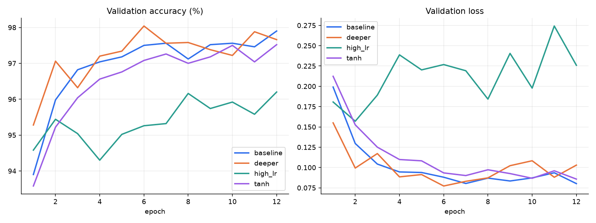
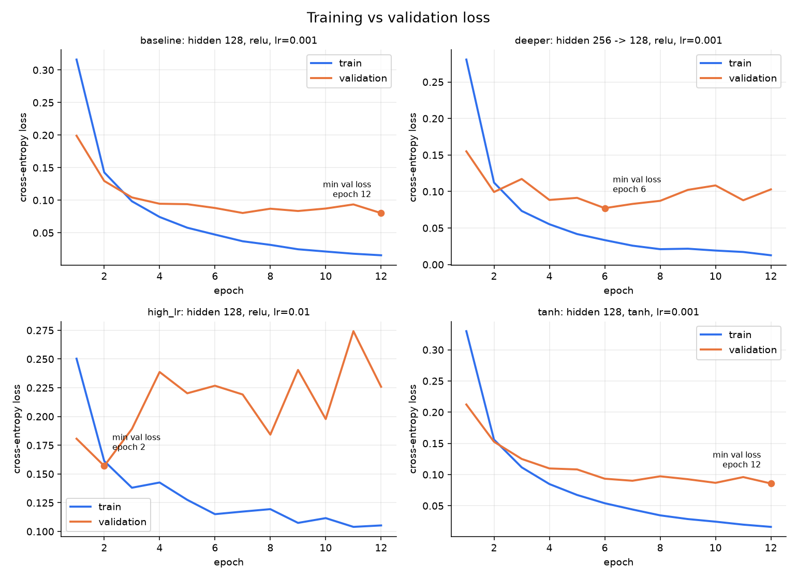
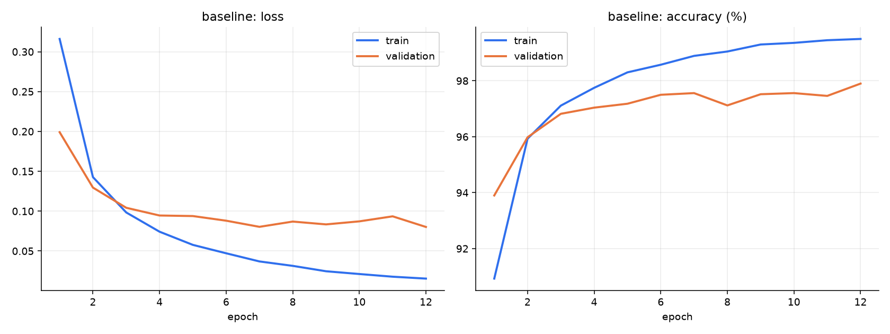
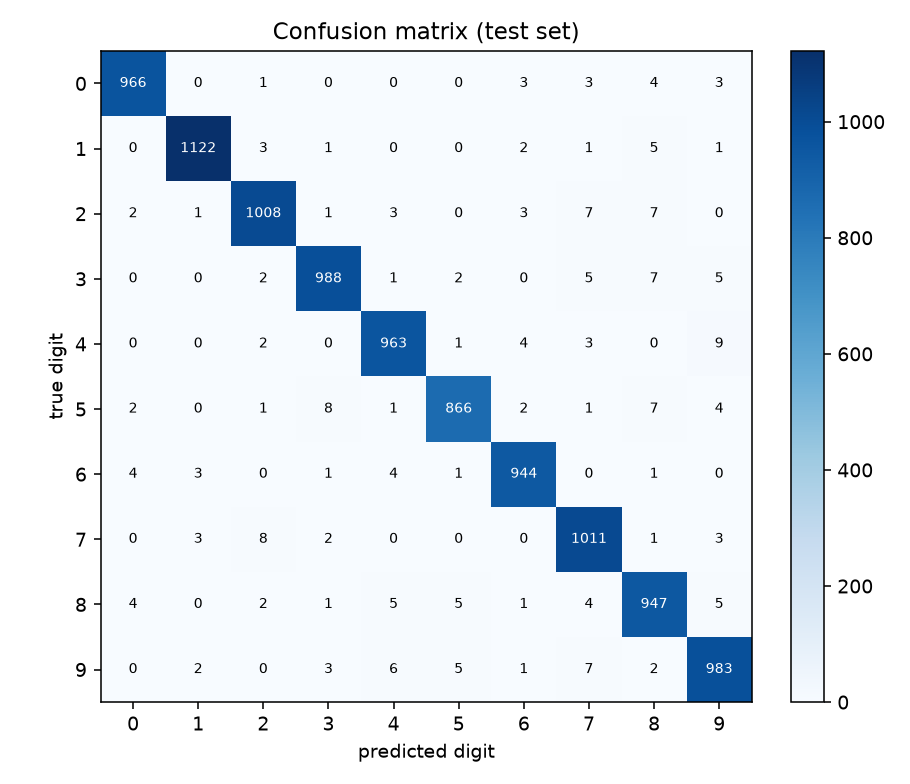
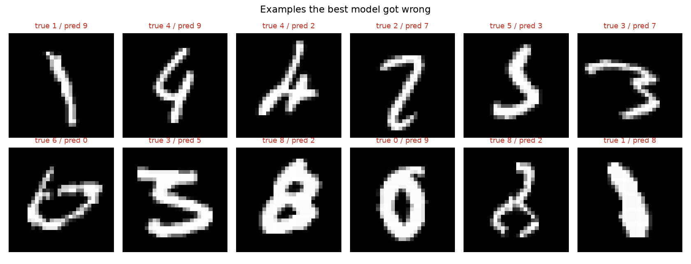

# ML-8: Deep Learning Intro (PyTorch, MNIST)

A fully connected neural network built and trained from scratch with PyTorch `torch.nn`, with a **manual training loop** (forward pass, loss, backward pass, optimizer step). Four architecture/hyperparameter variations are compared on a validation set, and only the best one is evaluated on the test set.

## Final result

**Test accuracy of the best configuration (`baseline`): 97.98%** (test loss 0.0775, 202 errors out of 10,000 images).

## Requirements checklist

| Requirement | Where |
|---|---|
| Architecture with input, hidden layers (non-linear activation) and output, using `torch.nn` | `build_model()` in `train.py` |
| Full training loop: forward, loss, backward, optimizer step (manual) | `train_one_epoch()` in `train.py` |
| Real dataset with a proper train/validation split | MNIST: 55,000 train / 5,000 validation / 10,000 test |
| Training and validation loss curves across epochs | `images/loss_curves_all.png` |
| At least 2 architecture/hyperparameter variations compared on validation performance | 4 configurations (below) |
| Final test accuracy | above |

## Dataset

MNIST handwritten digits (10 classes, 28x28 grayscale), loaded with `torchvision.datasets.MNIST`. The official 60,000-image training set is split with a fixed seed into 55,000 for training and 5,000 for validation. The official 10,000-image test set is used **once**, at the end, for the best configuration only. Pixels are scaled to [0, 1] and normalised with the MNIST mean (0.1307) and std (0.3081), then flattened to 784 values.

## Model

Best configuration (`baseline`), 101,770 trainable parameters:

```
Sequential(
  (0): Linear(in_features=784, out_features=128, bias=True)
  (1): ReLU()
  (2): Linear(in_features=128, out_features=10, bias=True)
)
```

## How the training loop works

For every mini-batch of 128 images (`train_one_epoch()` in `train.py`):

1. **Forward pass:** `logits = model(xb)` pushes the batch through the layers to produce 10 raw class scores.
2. **Loss:** `loss = nn.CrossEntropyLoss()(logits, yb)` compares the scores with the true digits (softmax + negative log-likelihood).
3. **Zero gradients:** `optimizer.zero_grad()` clears gradients from the previous step. PyTorch accumulates gradients by default, so skipping this silently corrupts training.
4. **Backward pass:** `loss.backward()` uses backpropagation to compute the gradient of the loss with respect to every weight.
5. **Optimizer step:** `optimizer.step()` updates the weights using Adam.

After each epoch the model is evaluated on the validation set with gradients disabled (`torch.no_grad()`) and in `eval()` mode.

## Experiments

All runs use the same seed (42), Adam optimizer, batch size 128 and 12 epochs. Only the listed settings change.

| Name | Settings | Parameters | Final train loss | Final val loss | Final val accuracy |
|---|---|---|---|---|---|
| baseline | hidden 128, relu, lr=0.001 | 101,770 | 0.0154 | 0.0802 | 97.90% |
| deeper | hidden 256 -> 128, relu, lr=0.001 | 235,146 | 0.0127 | 0.1029 | 97.66% |
| high_lr | hidden 128, relu, lr=0.01 | 101,770 | 0.1052 | 0.2259 | 96.20% |
| tanh | hidden 128, tanh, lr=0.001 | 101,770 | 0.0162 | 0.0857 | 97.52% |

The best configuration by final validation accuracy is **`baseline`** (97.90%), compared with 96.20% for the weakest (`high_lr`).



## Loss curves and overfitting check



- **baseline**: no clear overfitting. Validation loss ended at 0.0802 (minimum 0.0802 at epoch 12) with training loss 0.0154.
- **deeper**: validation loss was lowest at epoch 6 (0.0772) and rose to 0.1029 by epoch 12, while training loss kept falling to 0.0127. This is the overfitting pattern: the model keeps fitting the training set but stops generalising after about epoch 6.
- **high_lr**: validation loss was lowest at epoch 2 (0.1570) and rose to 0.2259 by epoch 12, while training loss kept falling to 0.1052. This is the overfitting pattern: the model keeps fitting the training set but stops generalising after about epoch 2.
- **tanh**: no clear overfitting. Validation loss ended at 0.0857 (minimum 0.0857 at epoch 12) with training loss 0.0162.

Curves of the selected configuration:



## Test results (best configuration, evaluated once)



The easiest digit was **1** (98.85% correct) and the hardest was **5** (97.09% correct).



## Run it

Windows PowerShell:

```powershell
python -m venv .venv
.\.venv\Scripts\Activate.ps1
pip install -r requirements.txt
python train.py
```

macOS / Linux:

```bash
python -m venv .venv && source .venv/bin/activate
pip install -r requirements.txt
python train.py
```

The script downloads MNIST into `data/`, trains all configurations, writes the plots to `images/`, the numbers to `results/results.json`, saves the best weights to `results/best_model.pt`, and regenerates this README with your results. Everything is seeded, so results are reproducible on the same machine and library versions.

## Project structure

```
train.py            # data, model, manual training loop, experiments, test evaluation
report.py           # plots + README generation (numpy/matplotlib only)
requirements.txt
images/             # all plots shown above
results/            # results.json, best_model.pt
```
